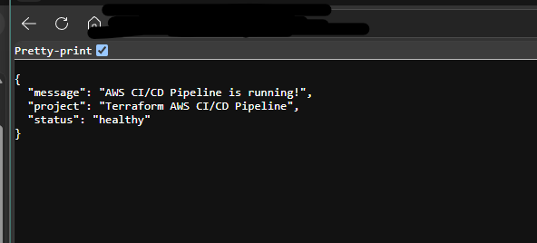
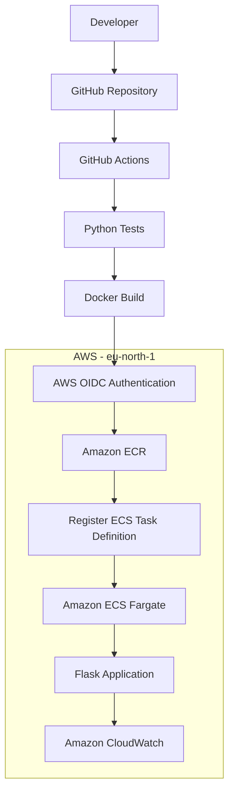

# Terraform AWS CI/CD Pipeline

**An end-to-end cloud deployment project using Terraform, AWS, Docker and GitHub Actions.**


## Project Overview

This project demonstrates the design and implementation of an automated CI/CD pipeline that builds, tests and deploys a containerised Python Flask application to Amazon ECS Fargate.

Infrastructure is provisioned using Terraform, while GitHub Actions automates application testing, Docker image creation, publishing to Amazon Elastic Container Registry (ECR) and deployment to Amazon ECS.

GitHub OpenID Connect (OIDC) provides secure, keyless authentication between GitHub Actions and AWS without storing long-lived AWS access keys.

**The result is a working application deployed to AWS through an automated deployment pipeline.**

## Live Application

The Flask application has been successfully deployed to Amazon ECS Fargate.

Example application response:

```json
{
  "message": "AWS CI/CD Pipeline is running!",
  "project": "Terraform AWS CI/CD Pipeline",
  "status": "healthy"
}
```



## Architecture

The architecture follows an automated deployment workflow from source code to a running container in AWS.

See the [full architecture documentation](docs/architecture.md).



## Technology Stack

| Technology | Purpose |
|---|---|
| Terraform | Infrastructure as Code |
| Amazon VPC | Network infrastructure |
| Amazon ECS Fargate | Container orchestration |
| Amazon ECR | Docker image registry |
| AWS IAM | Roles and permissions |
| GitHub Actions | CI/CD automation |
| GitHub OIDC | Keyless AWS authentication |
| Docker | Application containerisation |
| Python 3.12 | Application runtime |
| Flask | Web application framework |
| Gunicorn | Production WSGI server |
| Pytest | Application testing |
| Amazon CloudWatch | Application logging |

## AWS Infrastructure

The infrastructure is provisioned using Terraform in the AWS Stockholm region (`eu-north-1`).

Resources include:

- VPC with a dedicated public subnet.
- Internet Gateway and public route table.
- Security group allowing application traffic on TCP port 5000.
- Amazon ECR repository with image tag immutability and image scanning on push.
- ECS cluster running on AWS Fargate.
- ECS task definition configured for the Flask container.
- ECS task execution IAM role.
- GitHub Actions IAM role using OpenID Connect.
- CloudWatch log group with seven-day retention.

## CI/CD Pipeline

GitHub Actions automates the application testing, container build and deployment process.

### Continuous Integration

The CI workflows perform the following checks:

- Terraform formatting validation.
- Terraform initialisation and validation.
- Python dependency installation.
- Application tests using Pytest.
- Docker image build.

### Continuous Deployment

The deployment workflow performs the following steps:

1. Checks out the latest application source code.
2. Authenticates with AWS using GitHub OIDC.
3. Authenticates with Amazon ECR.
4. Builds the Docker image.
5. Tags the image using the Git commit SHA.
6. Pushes the image to Amazon ECR.
7. Registers an updated ECS task definition.
8. Updates the ECS service.
9. Waits for the ECS service to reach a stable state.

The deployment can also be triggered manually through GitHub Actions.

## Security Implementation

Security is incorporated into the infrastructure and deployment workflow.

### GitHub OIDC Authentication

- Uses GitHub's OIDC identity provider.
- Avoids storing permanent AWS access keys in GitHub.
- Restricts role assumption to the intended repository and main branch.

### AWS IAM

- Separate IAM roles for ECS task execution and GitHub Actions.
- Scoped permissions for ECR, ECS and IAM role passing.
- Restricted deployment role trust policy.

### Container Security

- Amazon ECR image scanning on push.
- Immutable image tags.
- Docker-based application packaging.

## Repository Structure

```text
terraform-aws-cicd-pipeline/
│
├── .github/
│   └── workflows/
│       ├── terraform.yml
│       ├── docker-ci.yml
│       └── deploy.yml
│
├── app/
│   ├── main.py
│   ├── requirements.txt
│   └── test_main.py
│
├── docs/
│   └── architecture.md
│
├── screenshots/
│   └── live-application.png
│
├── terraform/
│   ├── providers.tf
│   ├── variables.tf
│   ├── main.tf
│   ├── outputs.tf
│   ├── ecs.tf
│   ├── iam.tf
│   └── cloudwatch.tf
│
├── Dockerfile
├── .gitignore
└── README.md
```

## Deployment and Setup

### Prerequisites

- AWS account.
- Terraform installed.
- AWS CLI configured with appropriate permissions.
- Docker installed.
- GitHub repository.

### 1. Clone the repository

```bash
git clone https://github.com/AdenTechLab/terraform-aws-cicd-pipeline.git

cd terraform-aws-cicd-pipeline
```

### 2. Initialise Terraform

```bash
cd terraform

terraform init
```

### 3. Validate the configuration

```bash
terraform fmt -recursive

terraform validate
```

### 4. Review the infrastructure plan

```bash
terraform plan
```

### 5. Provision AWS infrastructure

```bash
terraform apply
```

Review the proposed changes and confirm when prompted.

### 6. Configure GitHub Actions variables

Add the following repository variables under:

**Settings → Secrets and variables → Actions → Variables**

| Variable | Description |
|---|---|
| AWS_REGION | AWS deployment region |
| AWS_ROLE_ARN | GitHub Actions IAM role ARN |
| ECR_REPOSITORY | Amazon ECR repository name |
| ECS_CLUSTER | Amazon ECS cluster name |
| ECS_SERVICE | Amazon ECS service name |

### 7. Deploy the application

Push an application change to the `main` branch or manually trigger the deployment workflow through GitHub Actions.

GitHub Actions will build, publish and deploy the updated container image to ECS Fargate.

## Application Endpoints

| Endpoint | Description |
|---|---|
| `/` | Main Flask application |
| `/health` | Application health check |

The application listens on port `5000`.

## Monitoring

Application logs are sent to Amazon CloudWatch Logs.

Log group:

```text
/ecs/terraform-aws-cicd-pipeline
```

Log retention is configured for seven days.

## Key Engineering Outcomes

Through this project, I implemented and demonstrated:

- Infrastructure provisioning using Terraform.
- Automated CI/CD using GitHub Actions.
- Docker containerisation of a Python application.
- AWS ECS Fargate deployment.
- Amazon ECR image management.
- Secure GitHub-to-AWS authentication using OIDC.
- IAM trust policies and scoped deployment permissions.
- AWS networking and security group configuration.
- Application testing and deployment verification.
- CloudWatch logging integration.

## Future Improvements

Potential enhancements include:

- HTTPS using an Application Load Balancer and AWS Certificate Manager.
- Custom domain configuration using Amazon Route 53.
- Multi-environment deployments for development and production.
- Automated rollback strategies.
- Terraform remote state using Amazon S3 with state locking.
- Enhanced monitoring and alerting.

## Author

**Aden Ibrahim**

Cloud Engineering | DevOps | Infrastructure Automation

- GitHub: [AdenTechLab](https://github.com/AdenTechLab)
- LinkedIn: [Connect on LinkedIn](https://www.linkedin.com/in/aden-ibrahim-a75051233/)

---

*This project was built as a practical demonstration of cloud infrastructure, automation, containerisation and continuous deployment using AWS and modern DevOps tooling.*
